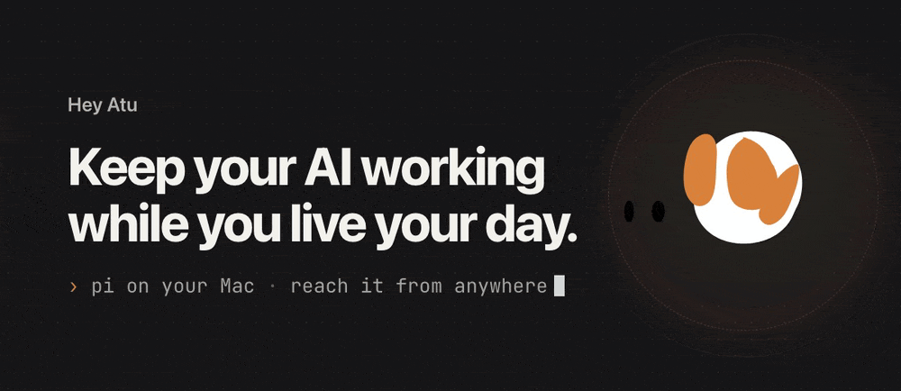
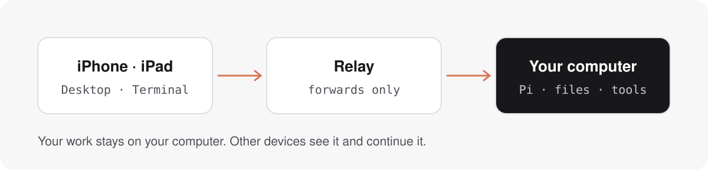

<p align="center">
  
</p>

<p align="center">
  <a href="https://heyatu.com/download/mac"><b>Download for Mac</b></a>
  &nbsp;·&nbsp;
  <a href="#install-from-terminal">Install from Terminal</a>
  &nbsp;·&nbsp;
  <a href="https://heyatu.com">heyatu.com</a>
  &nbsp;·&nbsp;
  <a href="https://github.com/heyatu/.github/blob/main/profile/README.zh-CN.md">中文</a>
</p>

Hey Atu is your own AI, on your own computer. It runs
[Pi](https://github.com/earendil-works/pi) on your Mac or Linux machine, with
your files, your tools and the model that you choose. You talk to it from the
device that is in your hand, and it continues the work when you walk away.


## How it works



- **Chats** — talk to Atu, by voice or text.
- **Todo** — Atu follows up on what you said you would do.
- **Updates** — Atu tells you when something you care about changes.
- **Wiki** — Atu keeps what you learn, in your own pages.

Atu works with the 30 model providers of Pi. Sign in with ChatGPT, Claude or GitHub Copilot, or add an API key:
[all providers](https://heyatu.com/models).

## Get started

| Device | Status |
|---|---|
| Mac | [Download](https://heyatu.com/download/mac) |
| Terminal (macOS, Linux) | Install command below |
| AI apps (Claude, ChatGPT, Codex) | [Hey Atu plugin](https://github.com/heyatu/heyatu-plugin) |
| iPhone, iPad, Apple Watch | Coming soon |

### Install from Terminal

```sh
curl -fsSL https://heyatu.com/install | sh
```

## Privacy

- Your files, tools and sessions stay on your computer.
- Messages between your devices and your computer are end-to-end encrypted.
- The relay forwards traffic. It does not read, store or log the content.
- Your computer opens no inbound internet port.
- The optional AI-app connection (MCP) uses TLS. It is not end-to-end encrypted.

[Security](https://heyatu.com/security) · [Privacy policy](https://heyatu.com/privacy) · [Pricing](https://heyatu.com/pricing) · [Support](https://heyatu.com/support)
