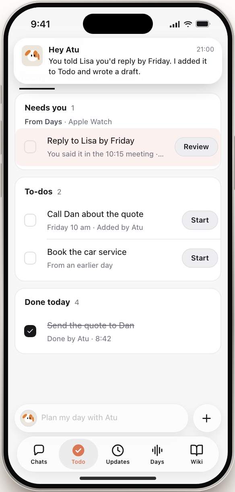
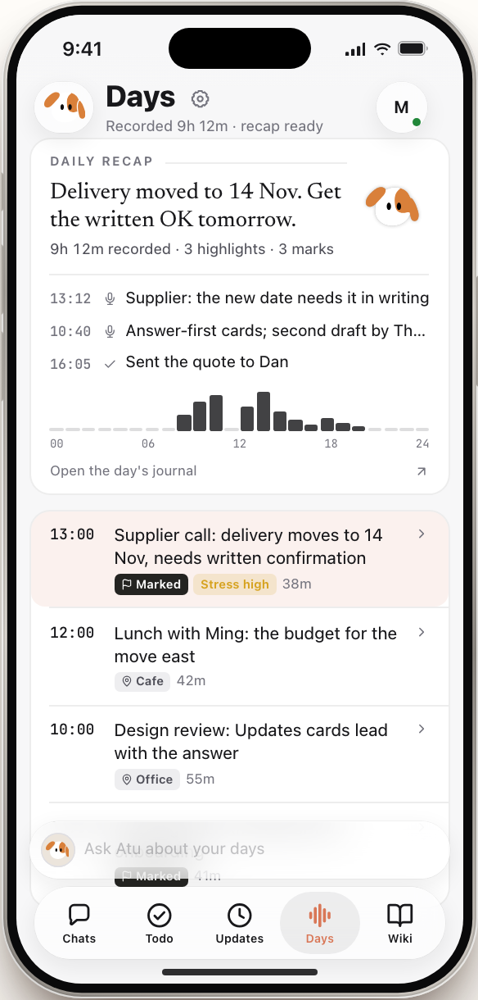
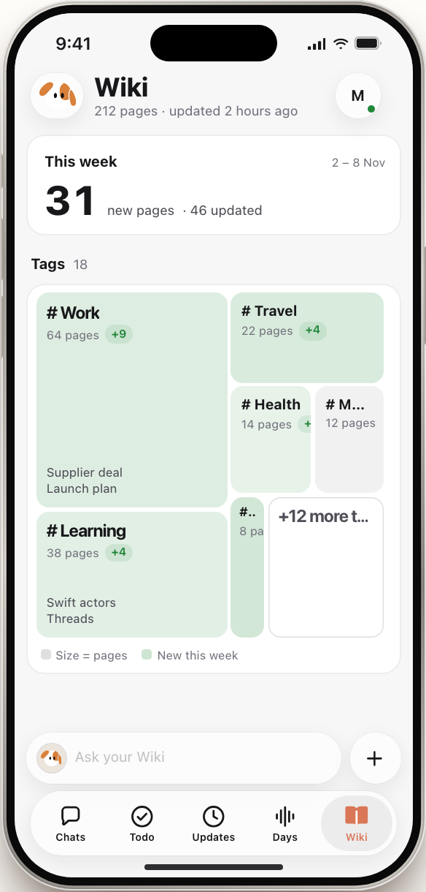
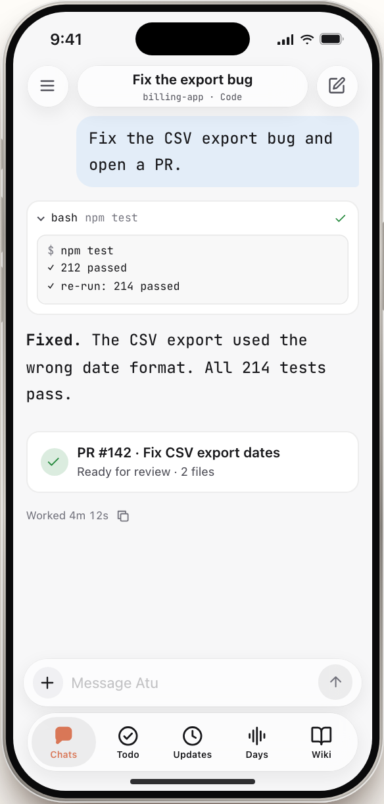

<p align="center">
  <a href="https://heyatu.com/?utm_source=github&utm_medium=readme&utm_campaign=hero"></a>
</p>

<p align="center">
  <a href="https://heyatu.com/download/mac?utm_source=github&utm_medium=readme&utm_campaign=nav-download"><b>Download for Mac</b></a>
  &nbsp;·&nbsp;
  <a href="#install-from-terminal">Install from Terminal</a>
  &nbsp;·&nbsp;
  <a href="https://heyatu.com/?utm_source=github&utm_medium=readme&utm_campaign=nav-home">heyatu.com</a>
  &nbsp;·&nbsp;
  <a href="https://github.com/heyatu/.github/blob/main/profile/README.zh-CN.md">中文</a>
</p>

Hey Atu is your own AI, on your own computer. It runs [Pi](https://github.com/earendil-works/pi) on your Mac or Linux machine, with your files, your tools and the model that you choose. You talk to it from the device that is in your hand, and it continues the work when you walk away.

<a href="https://heyatu.com/remote?utm_source=github&utm_medium=readme&utm_campaign=scene-continue"></a>

<p align="center">Start in the terminal, add a step from your phone, finish at your desk. One chat. <a href="https://heyatu.com/remote?utm_source=github&utm_medium=readme&utm_campaign=scene-continue-link">Use your computer from your phone →</a></p>

<a href="https://heyatu.com/organize-files?utm_source=github&utm_medium=readme&utm_campaign=scene-files"></a>

<p align="center">Ask once. Atu sorts the files where they are. Nothing is uploaded or deleted. <a href="https://heyatu.com/organize-files?utm_source=github&utm_medium=readme&utm_campaign=scene-files-link">Organise files with AI →</a></p>

<a href="https://heyatu.com/todo?utm_source=github&utm_medium=readme&utm_campaign=scene-chats"></a>

<p align="center">Everything you said during the day becomes to-dos, updates and pages. <a href="https://heyatu.com/todo?utm_source=github&utm_medium=readme&utm_campaign=scene-chats-link">How Todo fills itself →</a></p>

## How it works

<a href="https://heyatu.com/security?utm_source=github&utm_medium=readme&utm_campaign=how-it-works"></a>

<table>
<tr>
<td width="50%" valign="top"><a href="https://heyatu.com/iphone?utm_source=github&utm_medium=readme&utm_campaign=mode-chat"></a><br><b><a href="https://heyatu.com/iphone?utm_source=github&utm_medium=readme&utm_campaign=mode-chat-link">Chats</a></b><br>Talk to Atu by voice or text. It remembers how you work, so you say things once.</td>
<td width="50%" valign="top"><a href="https://heyatu.com/todo?utm_source=github&utm_medium=readme&utm_campaign=mode-todo"></a><br><b><a href="https://heyatu.com/todo?utm_source=github&utm_medium=readme&utm_campaign=mode-todo-link">Todo</a></b><br>Say “remind me on Friday” in any chat and it is on the list. Atu follows up before a task slips.</td>
</tr>
<tr>
<td width="50%" valign="top"><a href="https://heyatu.com/updates?utm_source=github&utm_medium=readme&utm_campaign=mode-updates"></a><br><b><a href="https://heyatu.com/updates?utm_source=github&utm_medium=readme&utm_campaign=mode-updates-link">Updates</a></b><br>Scheduled tasks on your Mac: a morning brief, a price watch, a weekly digest. A card comes only when there is news.</td>
<td width="50%" valign="top"><a href="https://heyatu.com/watch?utm_source=github&utm_medium=readme&utm_campaign=mode-days"></a><br><b><a href="https://heyatu.com/watch?utm_source=github&utm_medium=readme&utm_campaign=mode-days-link">Days</a></b><br>Your Apple Watch keeps the day. What you said becomes to-dos and notes. <i>Coming soon.</i></td>
</tr>
<tr>
<td width="50%" valign="top"><a href="https://heyatu.com/wiki?utm_source=github&utm_medium=readme&utm_campaign=mode-wiki"></a><br><b><a href="https://heyatu.com/wiki?utm_source=github&utm_medium=readme&utm_campaign=mode-wiki-link">Wiki</a></b><br>Links, files and chats become topic pages. They are Markdown files on your Mac that Obsidian can open.</td>
<td width="50%" valign="top"><a href="https://heyatu.com/remote?utm_source=github&utm_medium=readme&utm_campaign=mode-computer"></a><br><b><a href="https://heyatu.com/remote?utm_source=github&utm_medium=readme&utm_campaign=mode-computer-link">Your computer</a></b><br>Ask from your phone. Your Mac runs the tests, edits the files and sends back the result.</td>
</tr>
<tr>
<td width="50%" valign="top"><a href="https://heyatu.com/?utm_source=github&utm_medium=readme&utm_campaign=mode-spaces"></a><br><b><a href="https://heyatu.com/?utm_source=github&utm_medium=readme&utm_campaign=mode-spaces-link">Spaces</a></b><br>Describe a page, such as a family week or a run log. Atu makes it and keeps it up to date.</td>
<td width="50%"></td>
</tr>
</table>

<sub>iPhone screens with sample content. The iPhone, iPad and Watch apps are coming soon; the Mac app has the same tabs.</sub>

## Works with your models

Hey Atu runs on Pi, so it works with **30 model providers**. Sign in with your ChatGPT, Claude or GitHub Copilot plan, or add an API key: OpenAI, Anthropic, Gemini, DeepSeek, Qwen, Kimi, GLM, OpenRouter and more. Bedrock, Azure and Vertex AI work too. Change the model at any time; your chats stay on your computer. [All providers →](https://heyatu.com/models?utm_source=github&utm_medium=readme&utm_campaign=models)

## Lean on tokens

In an independent test, [Composio](https://composio.dev/content/best-ai-agent-harnesses) gave eight agent harnesses the same model (Kimi K3) and the same 25 real-app tasks. Pi had the fastest median time, used the fewest tokens and made the fewest tool calls.

| Agent | Median time | Cost per task | Passed |
|---|---:|---:|---:|
| **Pi (Hey Atu)** | **156s** | **$0.57** | 18/25 |
| Codex | 233s | $0.66 | 17/25 |
| OpenCode | 271s | $0.72 | 18/25 |
| Claude Code | 331s | $1.96 | 19/25 |

<sub>Composio, August 2026. Cost is per finished task. One run per task; costs use the Kimi K3 list prices of that month. Results vary by model and task.</sub>

## Run it anywhere

| Where | How |
|---|---|
| [Mac](https://heyatu.com/download/mac?utm_source=github&utm_medium=readme&utm_campaign=run-mac) | Download the app. macOS 13 or later, Apple silicon and Intel. |
| [Terminal and Linux](https://heyatu.com/terminal?utm_source=github&utm_medium=readme&utm_campaign=run-terminal) | One command on a Mac, a home server or a cloud machine. |
| [A spare computer](https://heyatu.com/spare-computer?utm_source=github&utm_medium=readme&utm_campaign=run-spare) | Turn an old Mac mini or laptop into an always-on agent. |
| [Claude and ChatGPT](https://heyatu.com/ai-apps?utm_source=github&utm_medium=readme&utm_campaign=run-ai-apps) | Add Hey Atu as a connector. The AI app does the task on your computer. |
| [iPhone, iPad, Apple Watch](https://heyatu.com/iphone?utm_source=github&utm_medium=readme&utm_campaign=run-iphone) | Coming soon. |

### Install from Terminal

```sh
curl -fsSL https://heyatu.com/install | sh
```

## Privacy

- Your files, tools and sessions stay on your computer.
- Messages between your devices and your computer are end-to-end encrypted.
- The relay forwards traffic. It does not read, store or log the content.
- Your computer opens no inbound internet port.
- The optional AI-app connection (MCP) uses TLS. It is not end-to-end encrypted.
- Your model provider sees what the AI sends to it, under its own data policy.

[Security](https://heyatu.com/security?utm_source=github&utm_medium=readme&utm_campaign=footer-security) · [Privacy policy](https://heyatu.com/privacy?utm_source=github&utm_medium=readme&utm_campaign=footer-privacy) · [Pricing](https://heyatu.com/pricing?utm_source=github&utm_medium=readme&utm_campaign=footer-pricing) · [FAQ](https://heyatu.com/faq?utm_source=github&utm_medium=readme&utm_campaign=footer-faq) · [Support](https://heyatu.com/support?utm_source=github&utm_medium=readme&utm_campaign=footer-support)
