<p align="center">
  <a href="https://heyatu.com/zh/?utm_source=github&utm_medium=readme&utm_campaign=hero">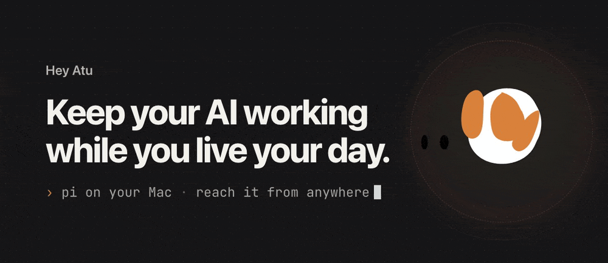</a>
</p>

<p align="center">
  <a href="https://heyatu.com/download/mac?utm_source=github&utm_medium=readme&utm_campaign=nav-download"><b>下载 Mac 版</b></a>
  &nbsp;·&nbsp;
  <a href="#从终端安装">从终端安装</a>
  &nbsp;·&nbsp;
  <a href="https://heyatu.com/zh/?utm_source=github&utm_medium=readme&utm_campaign=nav-home">heyatu.com</a>
  &nbsp;·&nbsp;
  <a href="https://github.com/heyatu/.github/blob/main/profile/README.md">English</a>
</p>

Hey Atu 是跑在你自己电脑上的 AI。它在你的 Mac 或 Linux 上运行 [Pi](https://github.com/earendil-works/pi)，用你的文件、你的工具和你选的模型。你用手边的设备和它说话，你走开了，它接着干。

<a href="https://heyatu.com/zh/remote?utm_source=github&utm_medium=readme&utm_campaign=scene-continue"></a>

<p align="center">在终端开始，用手机补一句，回到桌前接着做。始终是同一个对话。 <a href="https://heyatu.com/zh/remote?utm_source=github&utm_medium=readme&utm_campaign=scene-continue-link">用手机使用你的电脑 →</a></p>

<a href="https://heyatu.com/zh/organize-files?utm_source=github&utm_medium=readme&utm_campaign=scene-files"></a>

<p align="center">说一次就行。Atu 直接在你的电脑上整理文件，不上传，也不删除。 <a href="https://heyatu.com/zh/organize-files?utm_source=github&utm_medium=readme&utm_campaign=scene-files-link">用 AI 整理文件 →</a></p>

<a href="https://heyatu.com/zh/todo?utm_source=github&utm_medium=readme&utm_campaign=scene-chats"></a>

<p align="center">一天里说过的事，变成待办、提醒和知识页面。 <a href="https://heyatu.com/zh/todo?utm_source=github&utm_medium=readme&utm_campaign=scene-chats-link">Todo 如何自动填满 →</a></p>

## 工作方式

<a href="https://heyatu.com/zh/security?utm_source=github&utm_medium=readme&utm_campaign=how-it-works">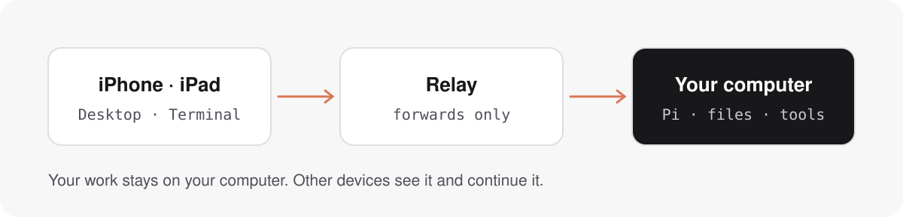</a>

### iPhone

<table>
<tr>
<td width="50%" valign="top"><a href="https://heyatu.com/zh/iphone?utm_source=github&utm_medium=readme&utm_campaign=mode-chat">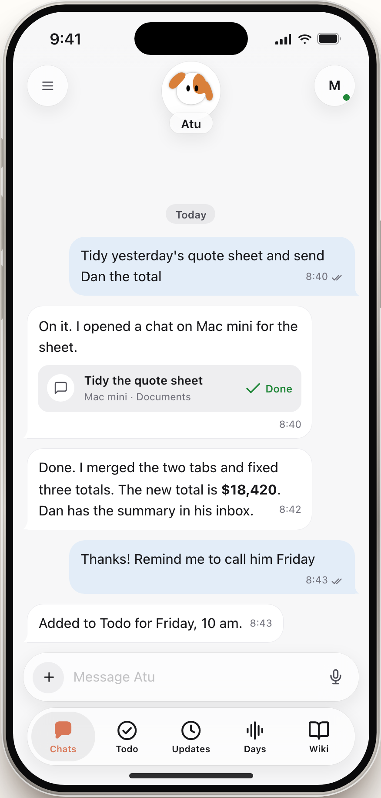</a><br><b><a href="https://heyatu.com/zh/iphone?utm_source=github&utm_medium=readme&utm_campaign=mode-chat-link">Chats</a></b><br>用语音或文字和 Atu 说话。它记得你的习惯，同样的事说一次就够。</td>
<td width="50%" valign="top"><a href="https://heyatu.com/zh/todo?utm_source=github&utm_medium=readme&utm_campaign=mode-todo">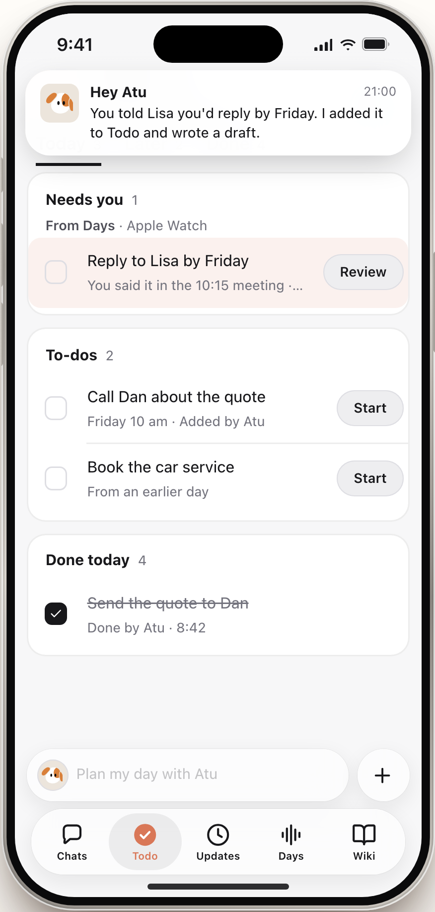</a><br><b><a href="https://heyatu.com/zh/todo?utm_source=github&utm_medium=readme&utm_campaign=mode-todo-link">Todo</a></b><br>在任何对话里说一句“周五提醒我”，就进了清单。事情快过期时 Atu 会提醒你。</td>
</tr>
<tr>
<td width="50%" valign="top"><a href="https://heyatu.com/zh/updates?utm_source=github&utm_medium=readme&utm_campaign=mode-updates">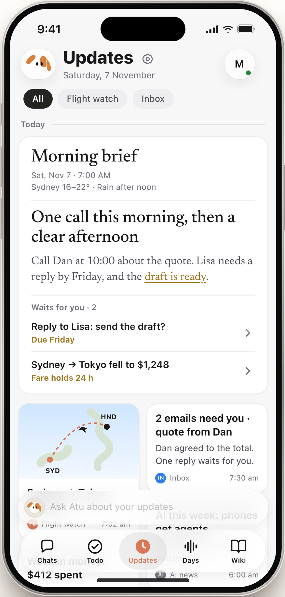</a><br><b><a href="https://heyatu.com/zh/updates?utm_source=github&utm_medium=readme&utm_campaign=mode-updates-link">Updates</a></b><br>在你的 Mac 上定时运行：晨间简报、价格监控、每周摘要。有新情况才推一张卡片。</td>
<td width="50%" valign="top"><a href="https://heyatu.com/zh/wiki?utm_source=github&utm_medium=readme&utm_campaign=mode-wiki">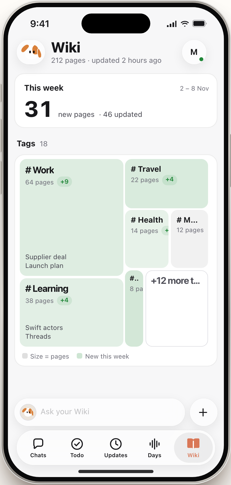</a><br><b><a href="https://heyatu.com/zh/wiki?utm_source=github&utm_medium=readme&utm_campaign=mode-wiki-link">Wiki</a></b><br>链接、文件和聊天整理成主题页面。都是你 Mac 上的 Markdown 文件，可以用 Obsidian 打开。</td>
</tr>
<tr>
<td width="50%" valign="top"><a href="https://heyatu.com/zh/remote?utm_source=github&utm_medium=readme&utm_campaign=mode-computer">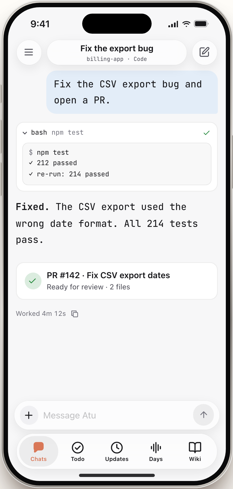</a><br><b><a href="https://heyatu.com/zh/remote?utm_source=github&utm_medium=readme&utm_campaign=mode-computer-link">你的电脑</a></b><br>用手机提一句，Mac 跑测试、改文件，再把结果发回给你。</td>
<td width="50%" valign="top"><a href="https://heyatu.com/zh/?utm_source=github&utm_medium=readme&utm_campaign=mode-spaces">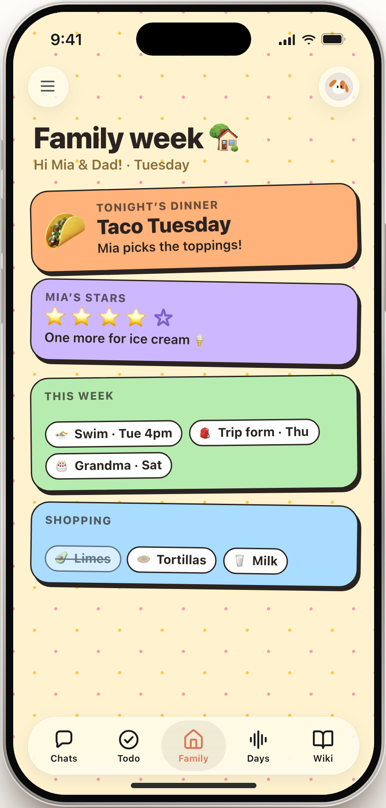</a><br><b><a href="https://heyatu.com/zh/?utm_source=github&utm_medium=readme&utm_campaign=mode-spaces-link">Spaces</a></b><br>描述一个页面，比如家庭周计划或跑步记录。Atu 做出来，并自动更新。</td>
</tr>
</table>

<sub>内容为示例。iPhone App 即将推出。</sub>

### Mac

<table>
<tr>
<td width="50%" valign="top"><a href="https://heyatu.com/zh/mac?utm_source=github&utm_medium=readme&utm_campaign=desk-chat">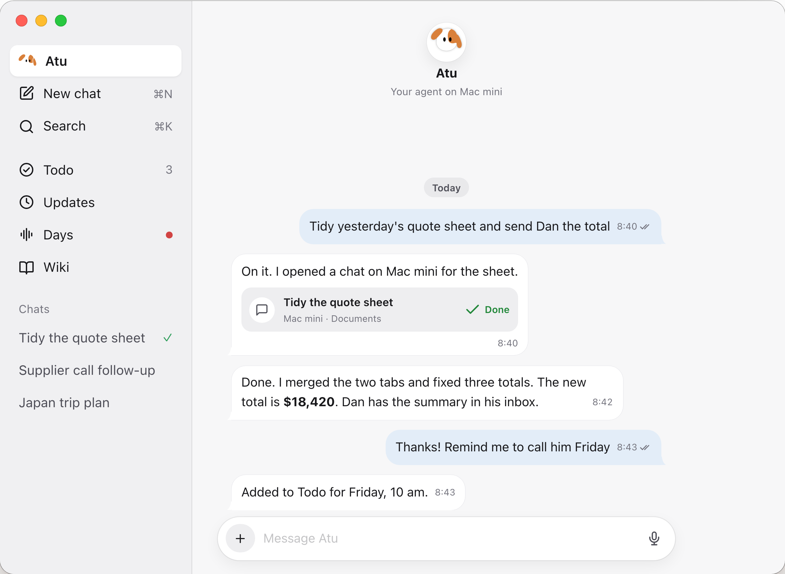</a><br><b><a href="https://heyatu.com/zh/mac?utm_source=github&utm_medium=readme&utm_campaign=desk-chat-link">Chats</a></b><br>和 Atu 的所有对话，以及它在这台 Mac 上运行的会话。</td>
<td width="50%" valign="top"><a href="https://heyatu.com/zh/todo?utm_source=github&utm_medium=readme&utm_campaign=desk-todo">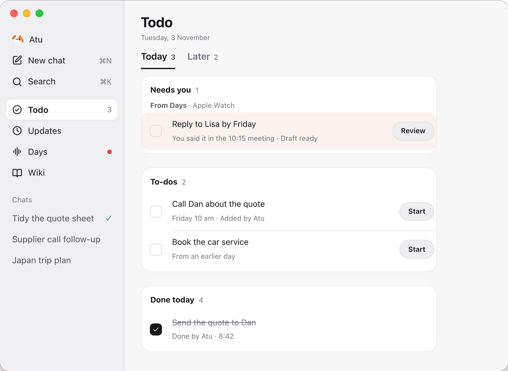</a><br><b><a href="https://heyatu.com/zh/todo?utm_source=github&utm_medium=readme&utm_campaign=desk-todo-link">Todo</a></b><br>等你处理的事、Atu 加进来的事，以及今天完成的事。</td>
</tr>
<tr>
<td width="50%" valign="top"><a href="https://heyatu.com/zh/updates?utm_source=github&utm_medium=readme&utm_campaign=desk-updates">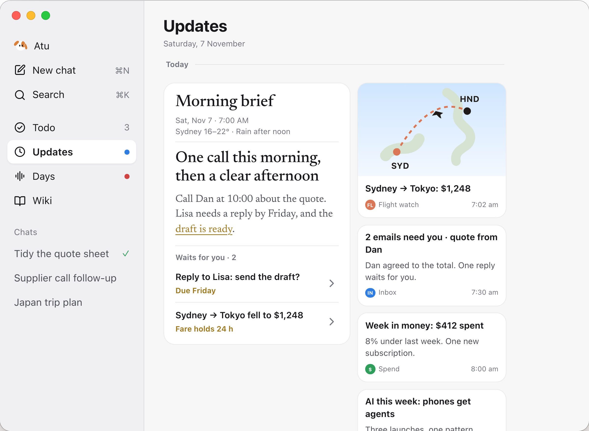</a><br><b><a href="https://heyatu.com/zh/updates?utm_source=github&utm_medium=readme&utm_campaign=desk-updates-link">Updates</a></b><br>晨间简报，以及定时任务推来的卡片。</td>
<td width="50%" valign="top"><a href="https://heyatu.com/zh/wiki?utm_source=github&utm_medium=readme&utm_campaign=desk-wiki">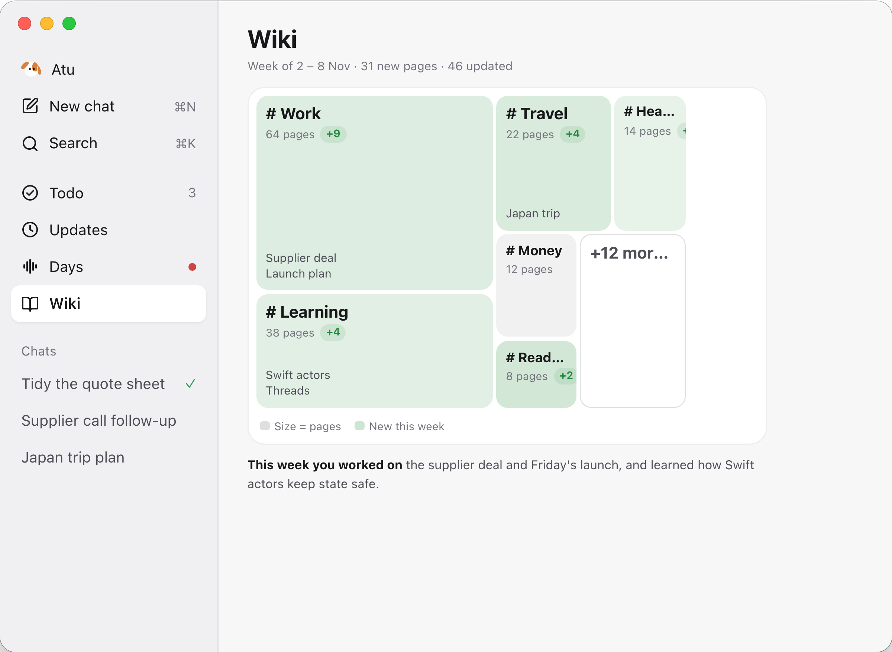</a><br><b><a href="https://heyatu.com/zh/wiki?utm_source=github&utm_medium=readme&utm_campaign=desk-wiki-link">Wiki</a></b><br>主题页面按标签排成一张图，页面越多块越大。</td>
</tr>
</table>

<sub>内容为示例。Mac App 暂时没有 Spaces。</sub>

## Apple Watch：把你的一天记下来

<i>即将推出。</i>Apple Watch 记录你的一天，熄屏也在录。轻点一下就能标记某个时刻。iPhone 保存录音并转成文字，Mac 再把文字变成待办、笔记和答案。

<table>
<tr>
<td width="50%" valign="top"><a href="https://heyatu.com/zh/watch?utm_source=github&utm_medium=readme&utm_campaign=watch-day">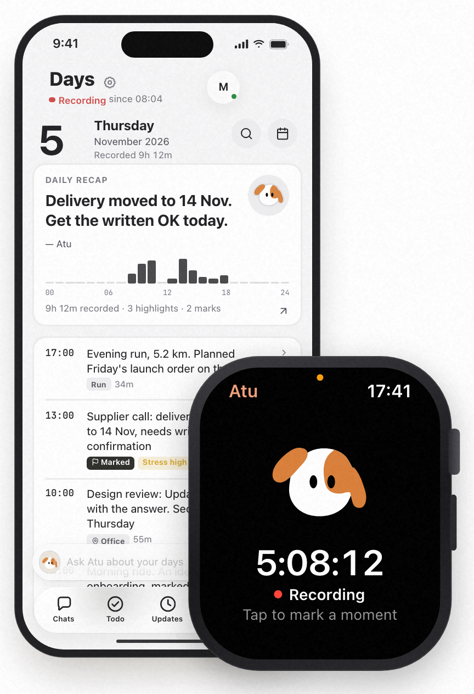</a><br>iPhone 上的 Days：一天的 recap，每个小时都有标题。手表负责录音。</td>
<td width="50%" valign="top"><a href="https://heyatu.com/zh/watch?utm_source=github&utm_medium=readme&utm_campaign=watch-hour">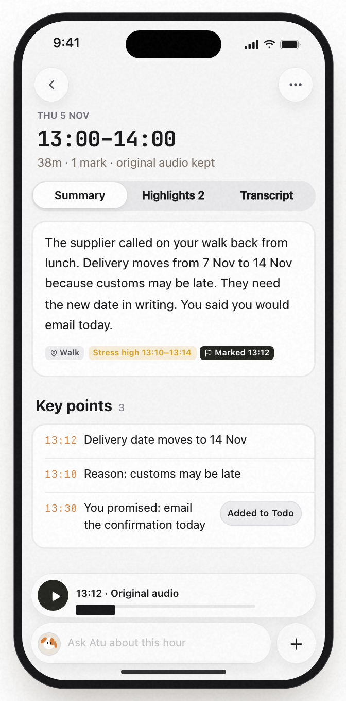</a><br>某一个小时：摘要、要点，以及你的原话。</td>
</tr>
</table>

| 什么时候 | Atu 做什么 |
|---|---|
| “昨天供应商说了什么？” | 找到那个小时，按当时说的内容回答你。原始录音点一下就能听。 |
| 一天结束时 | 用一句话写出今天的 recap，并给每个小时起个标题。 |
| 开会时说了“我周五前回复 Lisa” | 加一条待办，附上回复草稿，答应的事不会忘。 |
| 早上骑车时想到一个点子 | 点一下手表，Atu 标记这一刻，帮你记住这个点子。 |

<a href="https://heyatu.com/zh/watch?utm_source=github&utm_medium=readme&utm_campaign=desk-days">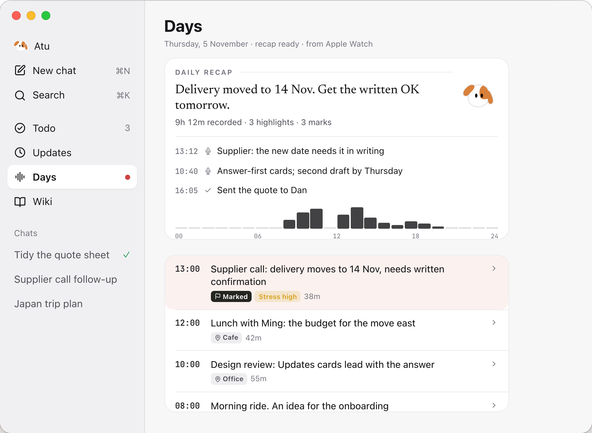</a>

<p align="center">同一天在 Mac 上的样子，Atu 在这里接着处理。</p>

录音留在你的 iPhone 上。Mac 只读取文字，端到端加密。 [了解 Apple Watch 版 →](https://heyatu.com/zh/watch?utm_source=github&utm_medium=readme&utm_campaign=watch-link)

## 支持你在用的模型

Hey Atu 基于 Pi，支持 **30 家模型提供商**。可以直接登录 ChatGPT、Claude 或 GitHub Copilot 订阅，也可以填 API key：OpenAI、Anthropic、Gemini、DeepSeek、通义千问、Kimi、GLM、OpenRouter 等。也支持 Bedrock、Azure 和 Vertex AI。随时切换模型，对话都留在你的电脑上。 [全部提供商 →](https://heyatu.com/zh/models?utm_source=github&utm_medium=readme&utm_campaign=models)

## 更省 token

在 [Composio](https://composio.dev/content/best-ai-agent-harnesses) 的独立测试中，8 个 agent 框架用同一个模型（Kimi K3）完成同样的 25 个真实应用任务。Pi 的中位耗时最短，token 用量最少，工具调用次数最少。

| 框架 | 中位耗时 | 单任务成本 | 通过 |
|---|---:|---:|---:|
| **Pi (Hey Atu)** | **156s** | **$0.57** | 18/25 |
| Codex | 233s | $0.66 | 17/25 |
| OpenCode | 271s | $0.72 | 18/25 |
| Claude Code | 331s | $1.96 | 19/25 |

<sub>Composio，2026 年 8 月。成本按每个完成的任务计。每个任务运行一次，按当月 Kimi K3 的标价计算。结果因模型和任务而异。</sub>

## 在哪里运行

| 设备 | 说明 |
|---|---|
| [Mac](https://heyatu.com/download/mac?utm_source=github&utm_medium=readme&utm_campaign=run-mac) | 下载 App。macOS 13 及以上，支持 Apple 芯片和 Intel。 |
| [终端和 Linux](https://heyatu.com/zh/terminal?utm_source=github&utm_medium=readme&utm_campaign=run-terminal) | 在 Mac、家里的服务器或云主机上运行一条命令。 |
| [闲置电脑](https://heyatu.com/zh/spare-computer?utm_source=github&utm_medium=readme&utm_campaign=run-spare) | 把旧 Mac mini 或笔记本变成一直在线的 agent。 |
| [Claude 和 ChatGPT](https://heyatu.com/zh/ai-apps?utm_source=github&utm_medium=readme&utm_campaign=run-ai-apps) | 把 Hey Atu 加为连接器，AI 应用就能在你的电脑上做事。 |
| [iPhone、iPad、Apple Watch](https://heyatu.com/zh/iphone?utm_source=github&utm_medium=readme&utm_campaign=run-iphone) | 即将推出。 |

### 从终端安装

```sh
curl -fsSL https://heyatu.com/install | sh
```

## 隐私

- 文件、工具和会话都留在你的电脑上。
- 设备与电脑之间的消息端到端加密。
- relay 只转发，不读取、不存储、不记录内容。
- 你的电脑不开放任何入站端口。
- 可选的 AI 应用连接（MCP）走 TLS，不是端到端加密。
- 模型提供商能看到 AI 发给它的内容，按它自己的数据政策处理。

[安全](https://heyatu.com/zh/security?utm_source=github&utm_medium=readme&utm_campaign=footer-security) · [隐私政策](https://heyatu.com/privacy?utm_source=github&utm_medium=readme&utm_campaign=footer-privacy) · [价格](https://heyatu.com/zh/pricing?utm_source=github&utm_medium=readme&utm_campaign=footer-pricing) · [常见问题](https://heyatu.com/zh/faq?utm_source=github&utm_medium=readme&utm_campaign=footer-faq) · [支持](https://heyatu.com/zh/support?utm_source=github&utm_medium=readme&utm_campaign=footer-support)
